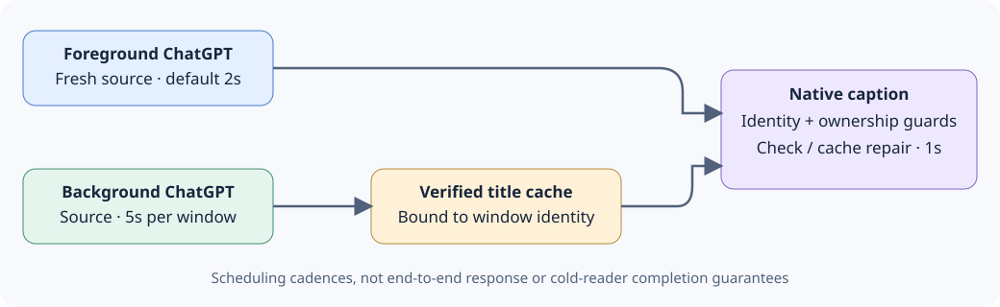

<p><a href="README.md"></a><a href="README.zh-CN.md"></a></p>

<p></p>

# ChatGPT-TitleSync · ChatGPT 标题同步助手

[简体中文](README.zh-CN.md) · [HTML](README.html) · [Support matrix](support-matrix.md) · [Guide index](docs/guides-index.md) · [v0.1.0 notes](docs/release-notes-v0.1.0.md) · [Roadmap](docs/roadmap.md)

Label native ChatGPT windows with their conversation names. Initial public preview: v0.1.0. Chinese product name: **ChatGPT 标题同步助手**. The foreground source interval defaults to **2 seconds**, background native-caption maintenance to **1 second**, and source refresh to **5 seconds per background window**.

The user approved public publication on **2026-11-11**. Confirmed repository: [ChatGPT-TitleSync](https://github.com/hpsun/ChatGPT-TitleSync). Start at sign-in is enabled by default; see the [startup guide](docs/startup.md). Verification coverage differs by implementation.

## Getting the files

This publication pushes normal repository files under each language directory, plus shared documentation and assets. **No project-produced ZIP is uploaded or offered as the project download.** Obtain the directory tree with Git, then follow the chosen [implementation guide](docs/guides-index.md):

```sh
git clone https://github.com/hpsun/ChatGPT-TitleSync.git
cd ChatGPT-TitleSync
```

The repository URL above is confirmed. Individual source files can also be opened or downloaded from their language directory. Keep the required companion files, icons and interpreter/runtime dependencies described by that guide; a Python frozen deployment is not an EXE-only installation. GitHub's automatically generated source archives, if displayed by the platform, are not ZIP files uploaded by this project.

## Contents

- [What changes](#scope)
- [Choose an implementation](#implementations)
- [Windows C# quick start](#quick-start)
- [Start at sign-in](docs/startup.md)
- [Monitoring and ownership](#behavior)
- [Validation status](#validation)
- [Selected icon](#icon)
- [Project layout](#layout)

<h2 id="scope">What changes</h2>

The intended native caption is `Conversation name — ChatGPT`. This labels a local window; it does not rename the conversation stored in ChatGPT.

On Windows, native captions can supply individual taskbar labels. This project does not change application grouping, application identity, or the name of a pinned shortcut. On macOS, a window title is separate from the application's Dock name; no Dock application rename is performed. Native macOS title writeability and visual effects remain unverified.

“Active” means the foreground native window on Windows. Metadata work checks ChatGPT identities and native captions; it does not inspect other applications' accessibility content. Source reads of background ChatGPT windows are scheduled separately. The experimental macOS designs still need native validation.

<h2 id="implementations">Choose an implementation</h2>

Each language implements its own monitoring and title logic. These are alternatives, not wrappers around the C# executable. AutoHotkey has separate runtime-specific sources.

| Implementation | Target and runtime | Guide |
| --- | --- | --- |
| C# | Windows, .NET Framework 4.x | [C# application](windows/csharp/README.md) |
| AutoHotkey Basic | Windows, Basic 1.0.48.05 ANSI x86; ASCII launch/runtime/IPC paths | [Basic compatibility](windows/ahk-v1.0/README.md) |
| AutoHotkey v1.1 | Windows, Unicode v1.1.33+, x86/x64 | [AHK v1.1](windows/ahk-v1.1/README.md) |
| AutoHotkey v2 | Windows, v2.0+, x86/x64 | [AHK v2](windows/ahk-v2/README.md) |
| PowerShell | Windows PowerShell / PowerShell on Windows; see tested versions | [PowerShell](windows/powershell/README.md) |
| Python | Windows, Python 3, standard library | [Python](windows/python/README.md) |
| Swift | macOS, **Experimental** native source | [Swift / Objective-C](macos/README.md) |
| Objective-C | macOS, **Experimental** native source | [Swift / Objective-C](macos/README.md) |
| Rust | Windows; experimental macOS AX source | [Rust](rust/README.md) |
| Go | Windows; experimental macOS cgo/AX source | [Go](go/README.md) |

Windows branches provide tray scan settings; Go/Rust and Python also offer optional CLI operation. Swift/Objective-C native menus and the public Go/Rust macOS osascript companion remain Experimental and have not been compiled or exercised on a Mac.

<h2 id="quick-start">Windows C# quick start</h2>

Build both local executables, then run the application:

```powershell
cd windows/csharp
powershell.exe -NoProfile -File .\Build.ps1
.\ChatGPT-TitleSync.exe
```

Activate a native ChatGPT window to start observing it. Use the tray's **Exit and restore titles**, or `ChatGPT-TitleSync.exe --stop`, to exit normally. Detailed options and a non-writing check are in the [C# guide](windows/csharp/README.md).

Choose one implementation at a time. Windows standalone implementations share a mutex and stop event. Avoid concurrently enabling another title-changing tool for the same windows.

Existing valid saved settings stay in effect; explicit command-line values override them for the launch. Fresh installations without settings default to foreground 2s and background 5s.

<h2 id="behavior">Monitoring and ownership</h2>



These are scheduling cadences, not end-to-end response or cold-reader completion guarantees.


| Layer | Default cadence | Work |
| --- | --- | --- |
| Native metadata | 1 second | Check ChatGPT identities/captions and repair background generic resets from a verified identity-bound cache |
| Foreground source | 2 seconds | Fresh current conversation name; never substitute a cached source value |
| Background source | 5 seconds per window | One serial bounded source worker; foreground work has priority |

`--interval` controls foreground source checks; `--background-interval 15` is an example of a custom background refresh. See each guide for ranges and timer limitations. A one-second schedule does not guarantee that a cold accessibility reader finishes in one second.

Windows binds HWND, PID, creation identity, class and executable path. Normal source reads follow a bounded native accessibility shell to `Document[RootWebArea].Name`; they do not traverse the conversation body or guess from the sidebar.

Background repair and refreshed source results can write only for the same identity and a generic `ChatGPT` caption or a caption still owned by this writer. Non-generic external captions are preserved. Unknown background windows get no invented cache; a successful low-frequency source read can establish one. The foreground always obtains fresh source results.

C# uses a persistent foreground watch with independent atomic heartbeat `Seq`/`HeartbeatUtc` and source `SourceSeq`/`ObservedUtc` snapshots, plus an independent background source role. Output files, cancellation signals, owned process handles and private kill-on-close Jobs are separated. Its private identity cache lets an upgrade resume background repair for the same still-existing window.

Normal exit restores only an identity-matching window whose current caption equals the last write. External changes are preserved. All language implementations have their own monitoring logic; PowerShell's in-memory Add-Type bridge is standard FFI, not an external C# executable dependency.

<h2 id="validation">Validation status</h2>

**Current revision:** real Windows retesting of default-on startup is in progress. The nine-runtime record below belongs to earlier sources and does not establish that this revision has completed all cases. Mac startup/native runtime remains unverified.


The [support matrix](support-matrix.md) distinguishes current controlled fixtures, historical read-only checks and unverified targets. Earlier C# component checks included **41 policy/timing cases, 13 watch/helper lifecycle cases, 8 source-interval protocol cases and 12 settings checks**. The public policy fixture duplicates that same 41-case set.

Fake or self-owned-window evidence is not full standalone tray, installation, long-term or taskbar visual acceptance. Current live acceptance and release gates are tracked in the [local validation summary](docs/release-readiness.md#local-validation).

Swift, Objective-C and macOS Go/Rust remain **Experimental: no Mac build or real AX/window-title acceptance**. Shared models are not native Mac tests. Remote CI definitions are not remote CI results.

Private caches, diagnostics and snapshots can contain conversation names and process identities. Keep them local. Generated binaries, SDK/runtime downloads, logs and validation evidence are excluded from the source package. See the [guide index](docs/guides-index.md).

Earlier targeted real-window checks passed for the preceding C# revision: foreground title transitions, background reset repair, configurable background scheduling, and normal stop/helper cleanup. Single observations were about 0.516s from the source timestamp to the first native-caption sample and 0.937s for background repair. These do not establish long-term, installation, complete tray or taskbar visual acceptance.

<h2 id="icon">Selected icon</h2>

**Palette 45 is the baseline:** a large ChatGPT motif with a blue-violet Title pill at the upper right, bold monospace lettering, and no outer blue frame. PNG, ICO and ICNS exports share this design; [selection metadata](assets/icon-selected.json) records the resource hashes. [Icon settings](docs/icon-themes.md) provide fixed palettes 45–52 or time-based random rotation.

Historical artwork remains available: [16 palettes](assets/chatgpt-titlesync-16-color-options.png), [blue/green combinations](assets/chatgpt-titlesync-blue-green-combinations.png), and [same-body candidates](assets/chatgpt-titlesync-blue-green-same-body.png).

<h2 id="layout">Project layout</h2>

```text
assets/                  Baseline 45, eight themes and historical candidates
windows/csharp/          C# application and isolated title reader
windows/ahk-v1.0/         AutoHotkey Basic ANSI x86 source
windows/ahk-v1.1/         AutoHotkey Unicode v1.1 source
windows/ahk-v2/           AutoHotkey v2 source
windows/powershell/      Self-contained PowerShell script
windows/python/          Standard-library Python script
macos/                   Experimental Swift and Objective-C sources
rust/                    Rust Windows and experimental macOS backends
go/                      Go Windows and experimental macOS backends
docs/guides-index.md     Guide coverage and remaining validation
support-matrix.json      Machine-readable verification status
source-sha256.txt        Relative-path source/build-file hashes
```

The source uses the [MIT license](LICENSE). See the [v0.1.0 notes](docs/release-notes-v0.1.0.md), [roadmap](docs/roadmap.md) and [release readiness](docs/release-readiness.md).

<!-- BEGIN TARGETED_WINDOWS_REAL -->
## Targeted real Windows acceptance — earlier revision, 2026-11-11

Nine Windows runtime cases used the same three existing ChatGPT windows, reused across runs. Each case compared one source/header target, exercised one foreground generic-caption reset and one background reset, and checked three original generic captions after normal exit. Settings were invoked through the bound native command/same menu handler; this is not a physical shell-right-click claim. The numbers below are individual reset-to-first-match observations, not benchmarks, cold-reader deadlines or long-term/install/taskbar guarantees. No Mac source was compiled or run.

| Runtime | Settings | FG reset | BG reset | Exit |
| --- | --- | ---: | ---: | --- |
| C# | 2/5 → 3/10 reopen → 2/5 | 1384ms | 781ms | 3 original generic captions |
| AHK Basic 1.0 | 2/5 → 3/10 reopen → 2/5 | 1098ms | 632ms | 3 original generic captions |
| AHK v1.1 | 2/5 → 3/10 reopen → 2/5 | 2247ms | 667ms | 3 original generic captions |
| AHK v2 | 2/5 → 3/10 reopen → 2/5 | 1056ms | 409ms | 3 original generic captions |
| PowerShell 5.1 | 2/5 → 3/10 reopen → 2/5 | 881ms | 794ms | 3 original generic captions |
| PowerShell 7 | 2/5 → 3/10 reopen → 2/5 | 342ms | 282ms | 3 original generic captions |
| Python | 2/5 → 7/17 reopen → 2/5 | 161ms | 379ms | 3 original generic captions |
| Rust | 2/5 → 3/10 reopen → 2/5 | 1018ms | 624ms | 3 original generic captions |
| Go | 2/5 → 3/10 reopen → 2/5 | 1784ms | 448ms | 3 original generic captions |

Python's cold source sample still had a generic native caption; the later valid foreground-reset original-title fingerprint matched the independently observed source. Two earlier foreground guards did not inject a reset and remain preserved, not counted as product failures. Python combined separate launches of the same frozen executable; its final settings check verified disk values and exact reopened control text at 7/17, then restored 2/5 within one process. The earlier unexplained 33/10 observation is retained; it is not rewritten as a proven product defect. The earlier C# hidden-first-show defect remains historical evidence; the table uses the repaired final executable.
<!-- END TARGETED_WINDOWS_REAL -->
