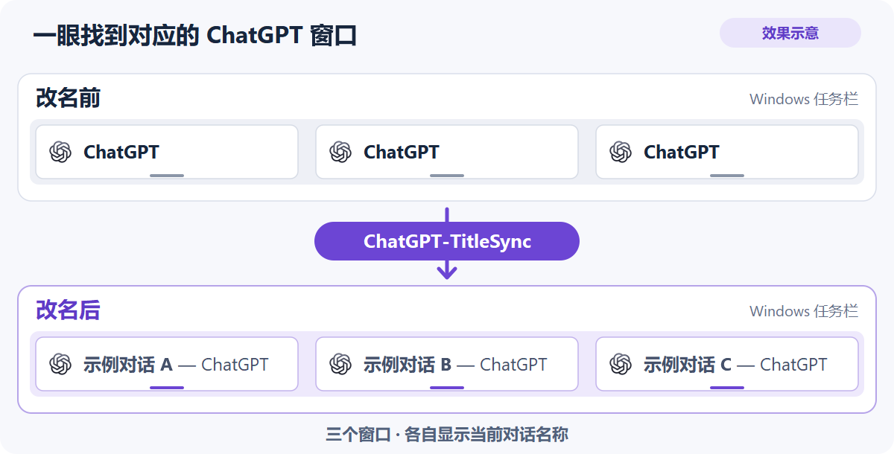
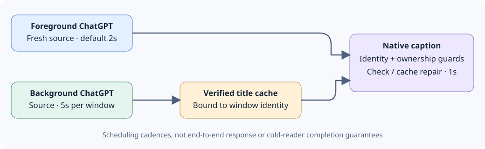

<p><a href="README.md"></a><a href="README.zh-CN.md"></a></p>

<p></p>

# ChatGPT 标题同步助手 · ChatGPT-TitleSync



此图为效果示意：程序只改变纯文本窗口标题，按钮宽度、字体、合并方式、主题及截断方式由 Windows 决定。

[English](README.md) · [HTML](README.zh-CN.html) · [支持矩阵](support-matrix.zh-CN.md) · [指南索引](docs/guides-index.zh-CN.md) · [v0.1.0发布说明](docs/release-notes-v0.1.0.zh-CN.md) · [路线图](docs/roadmap.zh-CN.md)

用当前对话名标识原生 ChatGPT 窗口。英文项目名为 **ChatGPT-TitleSync**，当前为首次公开预览 **v0.1.0**。缺省前台来源每 **2 秒**读取、后台原生标题每 **1 秒**维护、后台来源每窗口 **5 秒**刷新。

用户已于**2026-11-11明确批准公开发布**。已确认仓库：[ChatGPT-TitleSync](https://github.com/hpsun/ChatGPT-TitleSync)。缺省启用当前用户登录自启动，见[启动说明](docs/startup.zh-CN.md)；不同实现的验证范围仍分别说明。

## 可配置名称替换——功能分支

有序普通文字/正则规则缺省为空，不导入私人预设；当前名称复用私有已核实快照，预览和通用建议须明确**使用规则→保存**。

共享编辑器的 **Append — ChatGPT / 标题末尾显示ChatGPT** 复选框缺省勾选，按**保存**生效，与 **Enable name replacement** 及逐行开关独立：替换规则为空或停用时仍可关闭程序追加的后缀。共享 JSON 可选布尔项 `append_chatgpt_suffix` 缺项按 `true`，不属于扫描、图标或启动项偏好。

原始名/原标题恢复数据、手工标题保护与来源节拍不改。`--format`保留主体，附加`--caption`返回完整标题，见[后缀、来源边界与协议](docs/name-replacement.zh-CN.md#chatgpt-suffix)。Python与三AHK产品当前`--once`忽略这些已保存显示设置，须与常驻模式及旧API范围区分。

开发树版本仍为 **0.1.0**，下一目标为 **0.2.0**；本次未建立发布候选（RC）或新 Release，已有公开 v0.1.0 预览不代表这些尚未发布的改动已经交付。

## 获取文件

本次按语言目录逐文件推送源码、必要配套文件、文档与共享资源，采用正常仓库结构。**不上传或提供项目自制ZIP下载。** 可用Git获取目录树，再按[实现指南](docs/guides-index.zh-CN.md)运行：

```sh
git clone https://github.com/hpsun/ChatGPT-TitleSync.git
cd ChatGPT-TitleSync
```

已确认仓库地址为 https://github.com/hpsun/ChatGPT-TitleSync 。也可从对应语言目录打开或下载单个源码文件；需一并保留指南要求的伴随文件、图标及解释器/运行时依赖，不能把Python冻结目录当成仅一个EXE。GitHub若自动显示源码归档，那是平台生成的仓库视图，不是本项目上传ZIP。

## 目录

- [修改对象](#scope)
- [选择实现](#implementations)
- [Windows C# 快速开始](#quick-start)
- [登录自启动](docs/startup.zh-CN.md)
- [监听与所有权](#behavior)
- [验证状态](#validation)
- [已选图标](#icon)
- [项目目录](#layout)

<h2 id="scope">修改对象</h2>

期望的原生标题是“对话名 — ChatGPT”。它修改本地窗口的标签，不修改 ChatGPT 中保存的对话名称。

Windows 原生标题可作为任务栏单窗标签的来源，但本项目不修改应用分组、应用标识或固定快捷方式名称。macOS 窗口标题不同于应用 Dock 名称，本项目不重命名 Dock 应用；Mac 的标题可写性和显示效果仍待验证。

active 指 Windows 原生前台窗口。元数据检查仅核对 ChatGPT 身份及原生标题，不读取其他应用辅助内容；后台 ChatGPT 来源另按低频调度。macOS 设计仍需真实平台验证。

<h2 id="implementations">选择实现</h2>

各语言自行实现监听、读取与改名逻辑，是替代方案，不包装调用 C# EXE。AutoHotkey 按运行时分别交付。

| 实现 | 平台与运行时 | 指南 |
| --- | --- | --- |
| C# | Windows，.NET Framework 4.x | [C# 应用](windows/csharp/README.zh-CN.md) |
| AutoHotkey Basic | Windows，Basic 1.0.48.05 ANSI x86；启动／解释器／IPC 路径需 ASCII | [Basic 兼容说明](windows/ahk-v1.0/README.zh-CN.md) |
| AutoHotkey v1.1 | Windows，Unicode v1.1.33+，x86/x64 | [AHK v1.1](windows/ahk-v1.1/README.zh-CN.md) |
| AutoHotkey v2 | Windows，v2.0+，x86/x64 | [AHK v2](windows/ahk-v2/README.zh-CN.md) |
| PowerShell | Windows PowerShell／Windows 上的 PowerShell，见实测版本 | [PowerShell](windows/powershell/README.zh-CN.md) |
| Python | Windows，Python 3 标准库 | [Python](windows/python/README.zh-CN.md) |
| Swift | macOS，**Experimental 实验源码** | [Swift／Objective-C](macos/README.zh-CN.md) |
| Objective-C | macOS，**Experimental 实验源码** | [Swift／Objective-C](macos/README.zh-CN.md) |
| Rust | Windows；macOS AX 后端为实验源码 | [Rust](rust/README.zh-CN.md) |
| Go | Windows；macOS cgo／AX 后端为实验源码 | [Go](go/README.zh-CN.md) |

Windows分支均提供托盘扫描设置，Go／Rust与Python也可选择CLI。Swift／Objective-C客户端已有下列CI编译证据；原生菜单与Go／Rust公开osascript伴随菜单继续标Experimental，真实Mac菜单／编辑器／AX／登录行为未验收。

<h2 id="quick-start">Windows C# 快速开始</h2>

在本机构建两个 EXE，再运行应用：

```powershell
cd windows/csharp
powershell.exe -NoProfile -File .\Build.ps1
.\ChatGPT-TitleSync.exe
```

激活一个原生 ChatGPT 窗口后才开始观察它。通过托盘 **Exit and restore titles** 或 `ChatGPT-TitleSync.exe --stop` 正常退出。选项和不写入的检查方法见 [C# 指南](windows/csharp/README.zh-CN.md)。

每次选择一个实现。Windows 独立版本共用互斥量与停止事件；不要同时启用其它工具对同一窗口改名。

已有合法用户保存设置继续有效，显式命令行参数在启动时优先；无保存设置的新安装缺省前台2秒、后台5秒。

<h2 id="behavior">监听与所有权</h2>



图中标注是调度间隔，不是端到端响应或冷读取完成保证。


| 层次 | 缺省频率 | 处理 |
| --- | --- | --- |
| 原生元数据 | 1 秒 | 核对 ChatGPT 身份／标题；后台被改回通用标题时用绑定该身份的可信缓存修复 |
| 前台来源 | 2 秒 | 新鲜读取当前对话名，绝不用缓存代替本次读取 |
| 后台来源 | 每窗口 5 秒 | 单个串行、有期限的读取角色；前台优先 |

`--interval` 控制前台来源间隔，`--background-interval 15` 可将后台刷新设为 15 秒。范围和计时器边界见各指南。每秒调度不等于冷启动辅助读取一定在 1 秒内完成。

Windows 绑定 HWND、PID、进程创建身份、窗口类和程序路径。正常来源只沿有界原生辅助壳路径到 `Document[RootWebArea].Name`，不下探对话正文、不根据侧栏猜测。

后台缓存修复及新来源结果，只能写身份相同且当前为通用 `ChatGPT` 标题或仍由本写入者持有的窗口；非通用外部标题予以保留。未知后台窗口不凭空获得缓存，低频来源读取成功后才建立。前台始终取得新鲜来源。

C# 前台保持分别发布心跳`Seq`/`HeartbeatUtc`和来源`SourceSeq`/`ObservedUtc`原子快照的 watch；后台来源使用独立角色。二者的输出文件、取消信号、自有进程句柄和退出回收 Job 互相分离。私有身份缓存使升级后可继续维护身份未变的后台窗口。

正常退出只还原身份相同、且当前标题等于本次最后写入值的窗口，外部修改不覆盖。各语言分别实现监听；PowerShell 的内存 Add-Type 桥是标准互操作，不依赖外部 C# EXE。

<h2 id="validation">验证状态</h2>

**当前功能状态：**Windows通过 **46／46项共同CLI**（31 body＋15 caption）；另有helper专项 **37项**（22保留body＋15 caption），两套有重叠，不能相加为83。C#显示10项、始终隐藏编辑器13项通过；均为受控组件结果，不是正常桌面验收。负载下1.5秒WorkerTimeout可使已保存false仍显示缺省尾巴，失败缓存须由规则/helper身份、原名变化或重启刷新。两host低载单项成功不能称无条件通过，见[确切负载边界](KNOWN_ISSUES.zh-CN.md#format-worker-deadline-under-load)。


[支持矩阵](support-matrix.zh-CN.md) 区分当前受控夹具、历史只读与未验证目标。当前 C# 组件检查含 **41项策略/计时、13项watch/工作进程生命周期、8项来源间隔协议及12项设置检查**。公开策略夹具复现同一组41项，不另重复累计。

fake／自有窗口证据不等于完整的独立托盘、安装、长期驻留或任务栏视觉验收。真实窗口验收及发布门槛另见[本地验证摘要](docs/release-readiness.zh-CN.md#local-validation)。

在 [Mac CI 检查点 `1b7c33b`](https://github.com/hpsun/ChatGPT-TitleSync/actions/runs/43141369229)，**四种原生语言构建**（Swift、Objective-C、Go、Rust）、**31项共同格式化**、**5项文件I/O**及**3项客户端恢复**均通过；共享 AppleScript 编译仍在报告位置 `:64` 的 `application` 变量附近报 **-10003**，最小修正待验证。更新后缀修订的 **46项共同用例及7项客户端**仍须另一轮原生整合CI，**不在此检查点覆盖范围内**。真实ChatGPT AX/标题写入、编辑器/菜单GUI和登录行为未验证，Mac路线继续为Experimental。

私有缓存、诊断和工作快照可能含对话名及进程身份，应留在本地。生成的二进制、SDK／运行时下载、日志和验证证据不进入源码包。见[指南索引](docs/guides-index.zh-CN.md)。

C# 独立版真实窗口专项也已通过：前台标题切换、后台回改修复、可设后台调度及正常退出／helper 回收。单次观测为来源时间戳至首个原生标题样本约 0.516 秒、后台修复约 0.937 秒；这不等于长期、安装、完整托盘或任务栏视觉验收。

<h2 id="icon">已选图标</h2>

**45号为基准**：放大的ChatGPT主体，右上覆盖蓝紫色Title胶囊，粗等宽字体，取消蓝色外框。PNG、ICO、ICNS采用同一设计，[选择元数据](assets/icon-selected.json)记录资源哈希。[图标设置](docs/icon-themes.zh-CN.md)支持45—52固定配色或按周期随机更换。

历史候选：[16 色](assets/chatgpt-titlesync-16-color-options.png)、[蓝绿组合](assets/chatgpt-titlesync-blue-green-combinations.png)、[同一主体候选](assets/chatgpt-titlesync-blue-green-same-body.png)。

<h2 id="layout">项目目录</h2>

```text
assets/                  基准45、八色主题与历史候选
windows/csharp/          C# 应用与隔离读取器
windows/ahk-v1.0/         AutoHotkey Basic ANSI x86
windows/ahk-v1.1/         AutoHotkey Unicode v1.1
windows/ahk-v2/           AutoHotkey v2
windows/powershell/      独立 PowerShell 脚本
windows/python/          标准库 Python 脚本
macos/                   Swift／Objective-C 实验源码
rust/                    Rust Windows 与 Mac 实验后端
go/                      Go Windows 与 Mac 实验后端
docs/guides-index.md     指南覆盖与待验证事项
support-matrix.json      机器可读验证状态
source-sha256.txt        相对路径源码／构建文件哈希
```

源码采用 [MIT 许可](LICENSE)。本版内容见[v0.1.0发布说明](docs/release-notes-v0.1.0.zh-CN.md)，后续计划见[路线图](docs/roadmap.zh-CN.md)，验证边界见[发布准备](docs/release-readiness.zh-CN.md)。

<!-- BEGIN TARGETED_WINDOWS_REAL -->
## Windows真实窗口专项验收 — 旧修订，2026-11-11

9个Windows运行时案例复用同3个现存ChatGPT窗口，各案例比对1个来源/页头目标、有效注入1次前台通用标题重置及1次后台重置，并检查正常退出后3窗为原通用标题。设置经绑定原生指令/同一菜单处理器调用，不冒称系统托盘物理右键已实测。下列为单次重置到首次匹配观测，不是基准、冷读取时限或长期/安装/任务栏保证；这组历史Windows案例本身没有Mac原生编译或运行；后续CI检查点见上方。

| 运行时 | 设置 | 前台复原 | 后台复原 | 退出 |
| --- | --- | ---: | ---: | --- |
| C# | 2/5 → 3/10重开 → 2/5 | 1384ms | 781ms | 3窗原通用标题 |
| AHK Basic 1.0 | 2/5 → 3/10重开 → 2/5 | 1098ms | 632ms | 3窗原通用标题 |
| AHK v1.1 | 2/5 → 3/10重开 → 2/5 | 2247ms | 667ms | 3窗原通用标题 |
| AHK v2 | 2/5 → 3/10重开 → 2/5 | 1056ms | 409ms | 3窗原通用标题 |
| PowerShell 5.1 | 2/5 → 3/10重开 → 2/5 | 881ms | 794ms | 3窗原通用标题 |
| PowerShell 7 | 2/5 → 3/10重开 → 2/5 | 342ms | 282ms | 3窗原通用标题 |
| Python | 2/5 → 7/17重开 → 2/5 | 161ms | 379ms | 3窗原通用标题 |
| Rust | 2/5 → 3/10重开 → 2/5 | 1018ms | 624ms | 3窗原通用标题 |
| Go | 2/5 → 3/10重开 → 2/5 | 1784ms | 448ms | 3窗原通用标题 |

Python冷启动来源样本的原生标题仍通用；稍后有效前台重置的原标题指纹与独立来源完全一致，按跨时点证据记录。前两次前台守卫未注入重置，保留原档，不计产品失败。Python各项使用同一冻结EXE的不同启动批次；最终设置补证在同一进程中核验磁盘及重开控件精确7/17，再还原2/5。原先无法解释的33/10观察保留，不改写为已证产品缺陷。此前C#首显隐藏缺陷保留历史记录，表中使用修复后的最终EXE。
<!-- END TARGETED_WINDOWS_REAL -->
